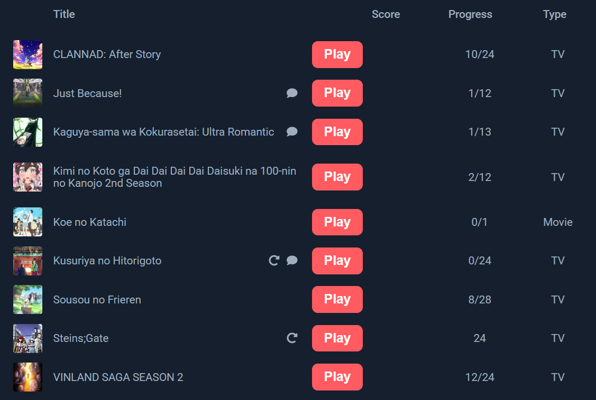
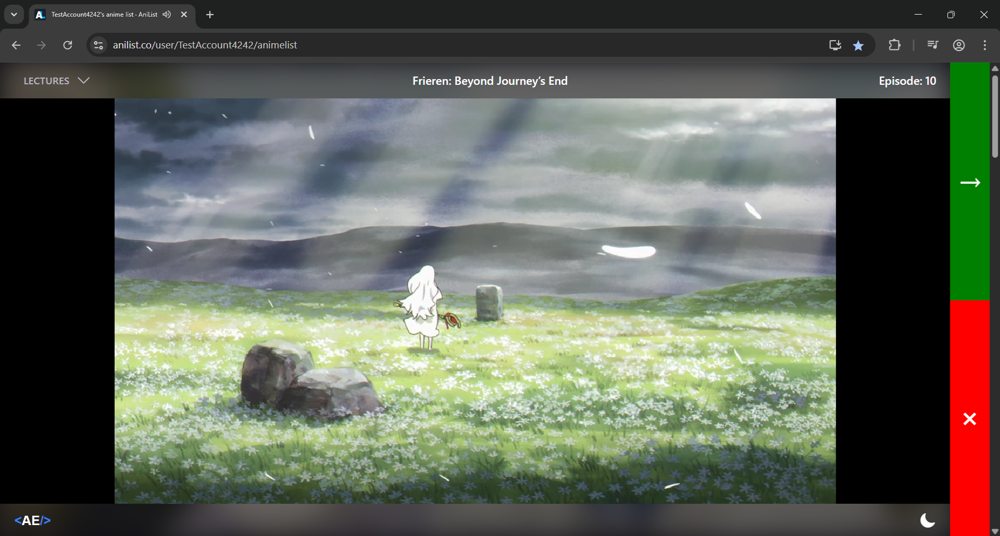

<div align="center">


A browser extension that enables anime streaming directly on [AniList](https://anilist.co/).





</div>

## 🛠️ How To Build

- Build w/ `npm`.

```
npm install
npm run build
```

- Load the project root folder as an unpacked extension in your browser.

---

<div align="center">
  Copyright &#169; 2025 PyroWilDx. All Rights Reserved.
</div>
